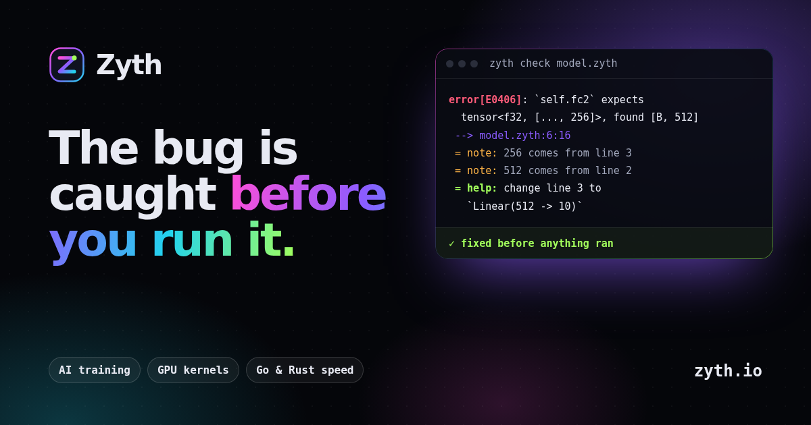

<div align="center">


<h1></h1>

### The programming language for AI work that catches the bug before you run it

**Zyth checks every tensor's shape, type and device before anything runs**, tells you where each
number came from and how to fix it, and then runs at Go and Rust speed, on GPUs from a laptop to a rack
of H100s, in the browser and inside React.

**Website: [zyth.io](https://zyth.io)**

**1.6 ms to start a built program** (Java: 24.2). **1,276 TFLOP/s of fp8 on one H100** (PyTorch: 1,125).
**100% of 202 tasks written right on the first try** by Claude and GPT.

[](LICENSING.md) [](LICENSING.md) [](#status) [](https://zyth.io)

<a href="https://zyth.io/play/"></a>&nbsp;<a href="https://zyth.io"></a>&nbsp;<a href="ZYTH-SPEC.md"></a>

<sub>The playground runs the real Zyth in your browser through WebAssembly. Nothing to install.</sub>

[**Website**](https://zyth.io) · [**Playground**](https://zyth.io/play/) · [**Demos**](https://zyth.io/demos/) ·
[**Specification**](ZYTH-SPEC.md) · [**Reference for AI models**](docs/llms.txt) · [**Standard library**](stdlib/) ·
[**What is in this repository**](#what-is-in-this-repository) · [**Licensing**](LICENSING.md)



</div>

---

## What is Zyth?

Today, AI work is Python on top, C++ and CUDA underneath, and JavaScript in front. **Zyth is one
language for all of it**, and its checker sees the whole program. A tensor's type says its shape, so a
layer that does not fit the one before it is an error before the program runs, not a crash at step 4,000:

```
error[E0406]: `self.fc2` expects tensor<f32, [..., 256]>, found tensor<f32, [B, 512]>
 --> model.zyth:6:16
  |
6 |         return x |> self.fc1 |> relu |> self.fc2
  |                ^^^^^^^^^^^^^^^^^^^^^ dimension 1 is 512, expected 256
  |
  = note: 256 comes from `Linear(256 -> 10)` at model.zyth:3
  = note: 512 comes from `Linear(784 -> 512)` at model.zyth:2
  = help: change line 3 to `Linear(512 -> 10)`
```

The same fix comes as JSON from `zyth check --json`, so an editor or an AI agent applies it for you.

```zyth
model Net {
    fc1 = Linear(784 -> 512)
    fc2 = Linear(512 -> 10)

    fn forward(self, x: tensor<f32, [B, 784]>) -> tensor<f32, [B, 10]> {
        return x |> self.fc1 |> relu |> self.fc2
    }
}

let net = Net().to(gpu)
print(net(tensor.randn(32, 784).to(gpu)).shape)    // [32, 10]
```

## Everything in one language

| | |
|---|---|
| **Train and fine-tune** | Automatic gradients, `zyth.nn`, AdamW, mixed precision; LoRA, SFT, DPO and GRPO; models from the Hugging Face Hub; GGUF and ONNX in and out. |
| **GPU kernels in Zyth** | `kernel fn` compiles to CUDA for NVIDIA, HIP for AMD, and WGSL for Apple, Intel and the browser, down to tensor-core tiles. |
| **Many GPUs, many machines** | Data, tensor, pipeline and expert parallelism, sharded weights, fp8 training, and `zyth launch` across machines with restarts from checkpoints. |
| **One file to ship** | `zyth build --release` compiles to machine code through LLVM and packs the program and its runtime into one executable. |
| **In the browser and React** | Build a program into a web page, or a component into an npm package; models run in WebAssembly, on the GPU through WebGPU. |
| **AI decisions as code** | `decide` lets a model pick one of the answers you wrote, within a budget, with a diary you can replay exactly. |
| **Packages with permissions** | Zyth, Python and npm packages, each limited to what its `allow` list grants; every version's hash in a public log. |
| **Written by AI** | Errors with exact fixes, an MCP server (`zyth mcp`), and a reference that fits in a prompt ([llms.txt](docs/llms.txt)). |

## Measured

Six programs in each language, built for release, best of 15 runs on one core (Linux, 2026-11-01), ms:

| Program | Zyth | Rust | Go | Java |
|---|---|---|---|---|
| start and exit | **1.6** | 1.7 | 1.9 | 24.2 |
| recursive fib(30) | **3.2** | 3.4 | 5.3 | 27.4 |
| count 300,000 words | **21.1** | 21.2 | 24.4 | 70.0 |
| sieve, 2M elements | **5.7** | 5.8 | 7.4 | 40.3 |
| split and parse text | 25.3 | **18.7** | 37.8 | 126.0 |
| update a list of structs | **1.8** | 1.9 | 3.6 | 55.2 |
| sort 300,000 numbers | 18.7 | **10.7** | 71.9 | 110.5 |

On an NVIDIA H100 against PyTorch on the same machine: fp8 products 1,276 TFLOP/s (PyTorch 1,125); an
fp8 training step 11.9 ms (torchao float8 compiled 12.7); attention forward and backward 0.66 ms
(FlashAttention-2 0.91). Every number, with what is still behind: [zyth.io/speed](https://zyth.io/speed/)
and [zyth.io/gpu](https://zyth.io/gpu/).

## What is in this repository

Zyth is free to download and use. **The parts you build on are open source here**, under Apache-2.0
or MIT, at your option:

| Part | Where |
|---|---|
| The language specification | [`ZYTH-SPEC.md`](ZYTH-SPEC.md) |
| The language reference for AI models | [`docs/llms.txt`](docs/llms.txt) |
| The standard library written in Zyth | [`stdlib/`](stdlib/) |
| Type definitions for Python and npm packages | [`registry/types/`](registry/types/) |
| The package tools: checksum log, auditor and witness, registry, package hashes | [`crates/zyth-pkg/`](crates/zyth-pkg/) |
| Editor support (VS Code) | [`editors/`](editors/) |
| Examples, samples and showcases | [`examples/`](examples/), [`samples/`](samples/), [`showcases/`](showcases/), [`packages/`](packages/) |

The compiler, checker, interpreter and runtimes are proprietary to BioDream LLC and free to use,
including for commercial work; the programs you make with them are yours. See [LICENSING.md](LICENSING.md).
Where these files mention paths such as `tests/`, `scripts/` or `crates/zyth-cli`, those are in the
compiler's sources, which are not published.

The package tools build on their own, so anyone can run, check and audit the checksum log Zyth relies on:

```sh
cargo test --release
```

## Status

**Preview.** The language and its tools are still changing. The first public release of the `zyth`
binaries is on its way; until then, everything runs in the [playground](https://zyth.io/play/) and the
[demos](https://zyth.io/demos/). Then it installs with one line:

```sh
curl -fsSL https://zyth.io/install.sh | sh        # Linux and macOS
irm https://zyth.io/install.ps1 | iex             # Windows (PowerShell)
```

## Contributing

Issues and pull requests are welcome for the parts in this repository: the specification, the standard
library, type definitions, the package tools, editor support and the examples. Contributions are accepted
under Apache-2.0 or MIT. Bugs in the compiler itself: open an issue with the smallest program that shows it.

## Who makes it

**BioDream LLC.** BioDream builds software for work where mistakes are expensive: healthcare integration
([Perfuse](https://github.com/BioDream-LLC/perfuse)), phone systems and 911
([BitVoice](https://github.com/BioDream-LLC/bitvoice), [bitdispatcher](https://github.com/BioDream-LLC/bitdispatcher)),
and rules that explain themselves ([quorum](https://github.com/BioDream-LLC/quorum),
[Vaglio](https://github.com/BioDream-LLC/vaglio)). Zyth is the language for the AI underneath.

Questions and commercial support: [**firstmind@biodream.ai**](mailto:firstmind@biodream.ai)

<div align="center">

[**zyth.io**](https://zyth.io) · [**biodream.io**](https://biodream.io) · [**github.com/BioDream-LLC**](https://github.com/BioDream-LLC)

<sub>© 2026 BioDream LLC</sub>

</div>
